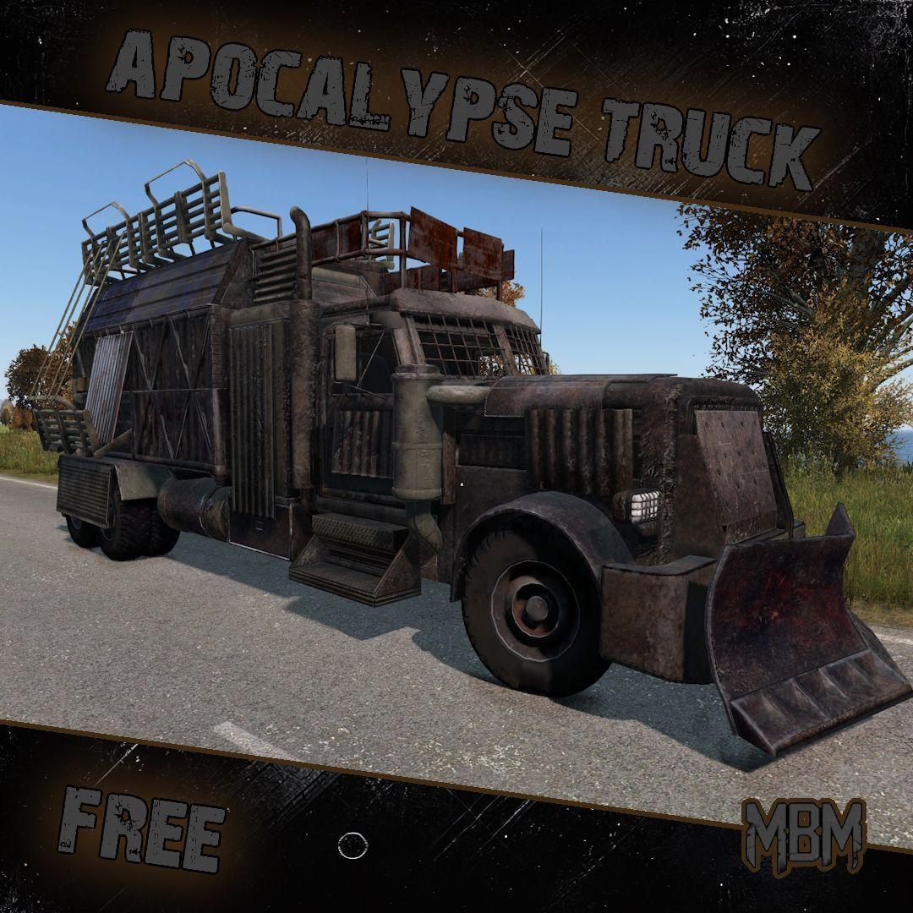

<div align="center">

# DAYZ · CENTRAL DE MODS

**Curadoria de 28 mods do Steam Workshop, organizados em 7 categorias, em uma página temática única.**

[](https://steamcommunity.com/app/221100/workshop/)
[](#-categorias)
[](https://steamcommunity.com/app/221100/workshop/)
[](LICENSE)
[](#-publicando-com-github-pages)



</div>

---

## 🎯 O que é

Uma **lista de sugestão de mods** para [DayZ](https://store.steampowered.com/app/221100/DayZ/) publicada como página HTML autocontida (`index.html`):

- 🖼️ **Imagens reais** — preview oficial de cada mod no Steam Workshop, embutido em base64 (a página funciona 100% offline);
- 📝 **Descrições em pt-BR** resumindo o que cada mod entrega de fato;
- 🔗 **Clique no card → página oficial do mod** na Steam Workshop (nova aba);
- 📊 Dados reais por mod: inscritos, avaliações, tamanho e dependências (`Community Framework`, `Code Lock`...);
- 🚩 Flags de atenção: `VERSÃO DEMO`, `EM DESENVOLVIMENTO`;
- 🔎 Busca instantânea + filtro por categoria;
- 🎨 Tema visual inspirado no universo do jogo (carvão, oliva, âmbar, stencil, faixa hazard).

> Basta abrir o `index.html` no navegador — não precisa de servidor, build ou internet.

## 🗂️ Categorias

| Categoria | Mods | O que cobre |
|---|:--:|---|
| 🏠 Casas & Bases | 5 | Construção *deployable* dentro do jogo (kits, estágios, garagens, Code Lock) |
| 🗺️ Assets de Mapa | 5 | Objetos estáticos para DayZ Editor / Object Builder |
| 🚗 Veículos | 6 | Carros, caminhões, pacotes apocalípticos e planador |
| 👕 Roupas & Equipamentos | 5 | Sets de vestuário, proteção NBC/QBRN e equipamento tático |
| 🔒 Armazenamento & Segurança | 2 | Cofres walk-in e prateleiras modulares |
| 💧 Água & Recursos | 2 | Poços e reservatórios funcionais |
| 🌾 Agricultura & Produção | 3 | Criação de animais, destilarias e mineração de cripto |

##  Estrutura do repositório

```
.
├── index.html                 # A página (autocontida: CSS, JS e imagens embutidos)
├── build.py                   # Gerador da página (Python 3 + Pillow)
├── tools/
│   └── update_workshop.py     # Re-sincroniza metadados/imagens com a API da Steam
├── data/
│   ├── mods_list.txt          # Lista-fonte: Nome|URL do Workshop (edite para add mods)
│   └── mods_meta.json         # Metadados vindos da API (inscritos, descrição, tamanho...)
├── images/                    # Previews oficiais baixados do Workshop (fonte do base64)
├── LICENSE                    # Licença do código (MIT)
└── README.md
```

## 🚀 Publicando com GitHub Pages

1. Neste repositório: **Settings → Pages**;
2. Em *Build and deployment* escolha **Deploy from a branch**;
3. Branch: `main` · pasta: `/ (root)` → **Save**;
4. Em ~1 minuto a página estará em `https://<seu-usuario>.github.io/<nome-do-repo>/`.

## 🛠️ Atualizando a lista

```bash
pip install pillow                      # única dependência do build
# 1) adicionou um mod novo? acrescente "Nome|URL" em data/mods_list.txt
#    e registre categoria/descrição pt-BR na lista MODS do build.py
python3 tools/update_workshop.py       # baixa metadados (API Steam) + previews
python3 build.py                       # regenera o index.html
```

O `update_workshop.py` usa a API pública `ISteamRemoteStorage/GetPublishedFileDetails`
(uma chamada para todos os ids) e baixa cada preview uma única vez.

## ⚖️ Créditos e avisos legais

- **Todos os mods, imagens e descrições pertencem aos seus autores** e estão hospedados na
  Steam Workshop (Valve). Esta página apenas organiza e linka para as páginas oficiais.
- Projeto **não oficial**, sem afiliação com Bohemia Interactive ou Valve Corporation.
- O código desta página/geradores é liberado sob licença [MIT](LICENSE).
- Respeite os termos de repack de cada autor antes de usar em packs de servidor.

---

<div align="center"><sub>Feito para a comunidade de Chernarus & Livonia 🧟 · atualizado em 15/10/2026</sub></div>
